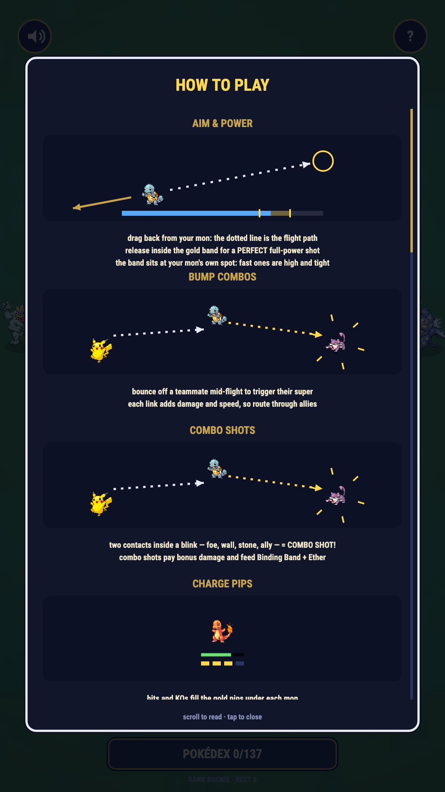
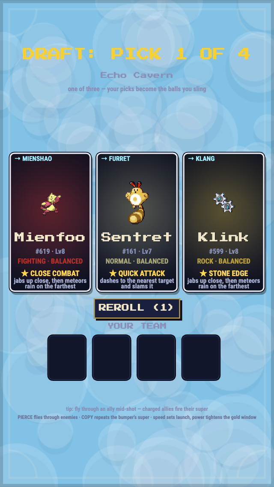
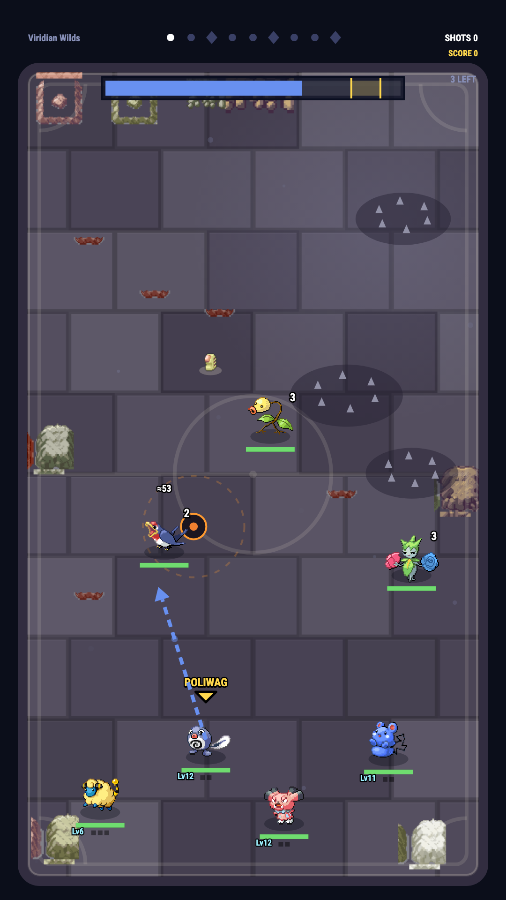
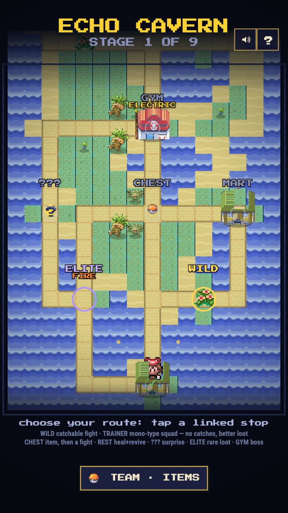
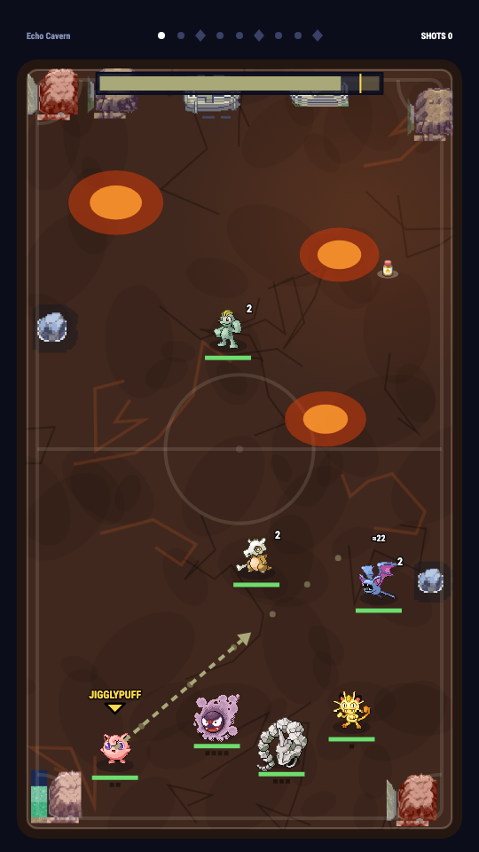
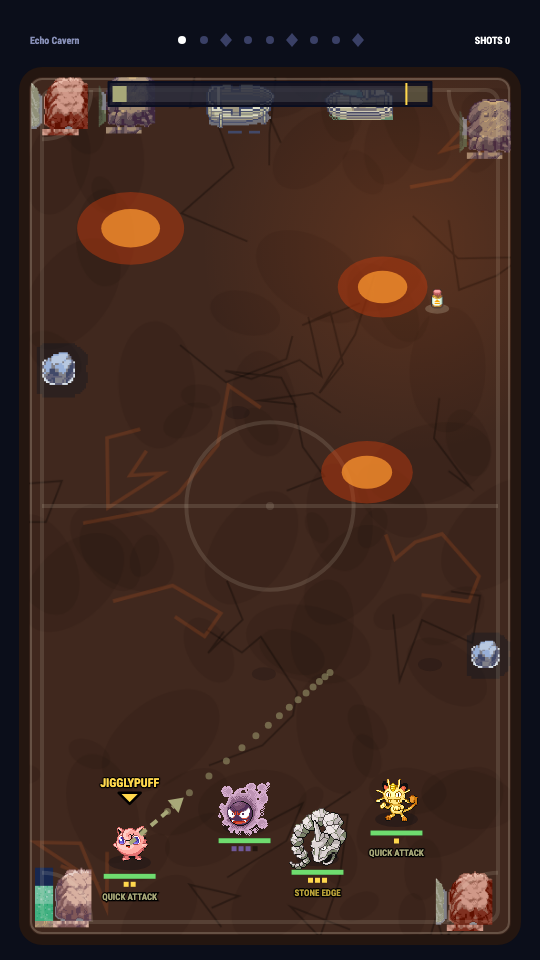

# Pokéstrike

**Monster Strike physics in a Pokémon skin, with a Slay the Spire climb.**
Pull back, launch your Pokémon, and bounce it around the arena smashing wild
mons — draft a team of 4, climb 9 stages, and take down all three gym
leaders to win the run.

| Title | Draft | Battle |
| --- | --- | --- |
|  |  |  |

| Region map | Aiming | Reward |
| --- | --- | --- |
|  |  |  |

## How to play

```bash
npm install
npm run dev    # serves on 0.0.0.0 — open the printed Network URL on your phone
```

The game is also deployed to GitHub Pages on every push to `main`
(`.github/workflows/deploy.yml`), so you can play from any device at
`https://<user>.github.io/pokestrike/`.

Open the printed URL. Works on desktop and touch.

1. Pick **Free Play** — a 9-stage climb (Slay the Spire style): random wild
   stages, a **gym leader** every 3rd stage, bigger and meaner packs as you
   go, and a win only when the third gym falls. **Daily Climb** is the same
   run for everyone today — one seed deals the same draft and stages.
   Enemy typing is hidden (`?`)
   until a mon takes a hit or attacks — you learn the matchup by engaging.
   Gym leaders bring same-type entourages and a **signature attack** (Mewtwo
   hunts you with psychic orbs, Dragonite fires a hyper beam line,
   Gyarados sweeps the court, Charizard scorches a ring), and every gym
   you beat lets you **keep the leader's ace** for your own team.
2. **Draft your team** — four rounds, one of three Pokémon each round, from a
   29-species pool of unevolved starters. Every round offers **three
   different types** so teams stay varied — the heavy hitters (Gengar,
   Snorlax, Dragonite…) aren't in the draft at all; you catch them mid-run.
   Each card shows the mon's **role** at a glance — **SPEEDSTER** (fast
   shot, combos), **TANK** (huge HP), **SNIPER** (long-range super,
   frail), **BRUISER** (heavy hits), **HEALER** (super heals the team),
   **WILD** (all-rounder) — plus its full base-stat block and any trait
   tag: **PIERCE** sails straight through enemies instead of bouncing off
   them, and **COPY** (Ditto) replays the super — stats, typing and
   cooldown — of whichever ally bumps it.
3. **Pull back to aim** — drag direction sets your launch angle and a dotted
   **guide line** previews the ball's banks off walls and rocks, ending on
   whatever it would hit first. **Power is timing**: a
   meter ping-pongs while you hold — release in the gold zone for a
   full-power `PERFECT!` shot (slow-mo + speedlines included).
4. Every enemy you bump takes damage with **type effectiveness** — gold `!`
   numbers are super effective, grey means resisted (or immune). Elites and
   bosses carry a **weak point** — a gold diamond marking one face; strike
   the ball in from that side for ×3 damage.
5. **Bump your own teammates** — every pass-through is a combo link (rising
   ×N counter, escalating hit-stop and flashes). Each ally's
   signature **super** starts uncharged and builds one notch per shot — the
   pip meter under its HP bar fills as it charges, all-gold means ready,
   and its move name appears overhead — that's the one you want to hit
   next. Enemies creep and dart toward your team and attack on a
   **countdown** — kill them or keep moving.
6. **Read the field** — each wave re-themes the court and the wilds match
   the stage's biome: grove draws grass-and-bird packs, cavern
   rock-and-ghost, volcano fire packs, sky flyers and electric. The court
   fights back too: **lava pools** scorch the ball and anything standing
   in them, **tall grass** drags your launch to a crawl, **wind bands**
   push the ball sideways, and **spike strips** chip it on contact — an
   **Air Balloon** item floats over all of it. **Field pickups** spawn
   each wave — the ball collects them by touch: **Oran Berry** heals the
   team, **Protein** boosts contact damage for the rest of the shot,
   **Elixir** knocks a notch off every super's cooldown. Heavy hits scar
   the court, and some spawn pairs sit close enough to pinch the ball
   between them for multi-hits.
7. **Catch 'em** — a KO has a chance to send the enemy to your **box**
   (`CAUGHT!` ball wiggle and all), and every cleared stage guarantees
   **one recruit** — beat a gym leader and their ace joins you. Swap boxed
   mons onto the team freely between stages — HP follows the mon, so
   benching never heals or revives. A **duplicate** catch doesn't waste a
   slot: it feeds the copy you own — the mon **evolves** if its line has a
   next stage, or the dupe becomes **rare candy** (a stat bump, or a team
   heal if it's benched). Evolved **elites** start appearing from stage 2
   and get common deeper in — and any normal wave can be **invaded** by a
   legendary (the birds, the beasts, Mew, Celebi) crashing in as a
   mini-boss worth catching. Bosses can be caught mid-fight too — a
   Master Ball item never fails. Rare **shiny** wilds (~1 in 48 spawns)
   sparkle gold — KO one and it's a guaranteed catch plus a score bonus.
8. **Choose a item between stages** (Slay the Spire style): heals, +max HP,
   +damage, faster recharges, launch speed, revive. Builds stack across the
   run — draft for synergy, item for the holes. **Type charms** (Charcoal,
   Mystic Water, Magnet…) give +20% to one type and stack — going mono-type
   is a real build. Then pick your **route** on the region map: non-gym rows
   offer 2–3 linked stops to tap — safe **wilds**, the **elite** road (bigger
   fight, uncommon-or-better items), Poké Center **rests** (+30% team HP),
   **item finds**, **blood shrines** (team −15% HP for a relic), and the
   **Poké Mart** (a relic for 500 score — power or the record). Gyms are
   forced singles every third row; the island itself is a seeded
   porygion-style value-noise map. The items you've taken ride the reward
   screen as an icon strip.
9. **It remembers you** — caught mons join your **dex** and can show up in
   future draft pools; gym wins raise your **rank**, and higher ranks unlock
   gated items in the pool. Your **best score** and **daily streak** live on
   the title screen — finishing a Daily Climb each day keeps the streak
   alive. Tap the dex count on the title for the **Pokédex** — every
   catchable species, lit when owned. Lose a run and that exact team comes
   back as a **RIVAL BATTLE**
   wave in your next one — beat it to clear the echo. Every clear raises
   your **ascension** (shown on the title): enemies get +15% bulk and +8%
   damage per tier, and pay a +20%/tier score premium.
9b. **Level up mid-run** — every KO feeds the mon that landed it a level
    (+5% damage, +3% max HP, up to Lv 20). Levels survive evolution and
    benching — they follow the mon. Feed your carry, not your bench.
9c. **Signature moves** — drafted/caught mons shout their *own* move
    (Pikachu `THUNDERBOLT`, Gyarados `TWISTER`, Mewtwo `PSYCHO BOOST`),
    and draft cards show the super you'll unlock. Draft cards can roll
    **shiny** (~1 in 50) too — a gold card stays gold for the whole run.
9d. **Before stage 1, choose your charm** — one of three held items to
    start the climb with, after a one-per-run draft **reroll** if the
    board is cold.
9e. **Perfect streaks and revenge** — back-to-back gold releases stack up
    to +28% shot damage (watch `PERFECT ×n` in the HUD); a fainted
    teammate surges the survivors +8% damage and a sip of HP.
10. **Share your result** — the result screen shows a Wordle-style emoji grid
    (🟩 cleared waves, 🟥 where you fell), your final team as real sprites,
    rarity-colored **run badges** (FLAWLESS, MEGA KO, BOSS THIEF, SHINY
    HUNTER…), and a `★ NEW RECORD ★` when you top your best. **SHARE RESULT**
    posts a trainer-card readout — team names, score, badges, the grid — and
    **REMATCH** drops you straight into a fresh draft (the Daily Climb
    re-seeds the same run).

## Real stats, real roles

Every species carries its canonical base stats (HP / Atk / Def / SpA / SpD /
Spe). The mapping is one rule: **physical attacks roll Attack vs Defense,
special attacks roll Sp.Atk vs Sp.Def.**

| Stat | What it does in Pokéstrike |
| --- | --- |
| HP | Max HP (players `60 + 1.15×`, bosses `5.8×`) |
| Attack | Damage when your launched Pokémon physically hits an enemy |
| Defense | Shrinks physical damage taken — contact hits and enemy zaps |
| Sp. Atk | Damage of the bump combo when an ally is hit mid-shot |
| Sp. Def | Shrinks special damage taken — boss blasts, poison ticks |
| Speed | Launch velocity for your team; approach speed for enemies |

So Pikachu (55 Atk / 90 Spe) is a fast skirmisher, Jigglypuff (115 HP / 20
Spe) is a slow tank, and Geodude's 100 Defense means physical hits bounce off —
hit it with special bump attacks instead. Damage mitigation is
`60 / (60 + def)` — a defender at 60 takes about half damage.

Supers shout their real move name (`PIKACHU used THUNDER!`), chain lightning
hops enemy to enemy, shockwave rings sweep the field, and everything is
backed by a procedural chiptune soundtrack
(title / battle / victory) plus synthesized WebAudio SFX and haptics — no
audio assets.

## Bump attacks by type

| Type | Ally bump attack |
| --- | --- |
| Fire | Flame Burst — a shockwave ring rolls out from the ally; enemies burn as the front passes over them and get shoved back |
| Electric | Chain lightning — hops between up to 3 enemies, each hit landing a beat apart |
| Grass | Drain field — damages enemies, heals your whole team by a quarter of what it dealt |
| Water | Hydro Pump — three homing orbs corkscrew into the nearest enemies and splash on impact |
| Psychic | Telekinetic shove — damage plus a real knockback impulse that flings enemies off walls and each other |
| Flying | Hurricane — a vortex drags every nearby enemy into a pile on the ally, setting up your next combo |
| Poison | Toxic — immediate hit plus poison that ticks a cut of max HP after each of your shots; re-toxining stacks it |
| Rock / Fighting | Meteor fist — the nearest enemy eats a one-two; the second hit lands a beat later and scars the court |
| Ghost | Hex — a weak hit on every enemy on the field |
| Normal | Quick Attack — the ally physically dashes to the nearest enemy, slams it, and stays beside it |

## Install it like an app

The game ships a PWA: `manifest.webmanifest`, icons, and a cache-first service
worker (`public/sw.js`) registered only in production builds.

- **iOS**: open the deployed site in Safari → Share → Add to Home Screen
- **Android/desktop**: the install prompt appears in the browser
- **Native wrapper**: `npm run build`, then wrap `dist/` with
  [Capacitor](https://capacitorjs.com) (`npx cap init` → `npx cap add ios`) —
  the game is one self-contained static bundle with no backend.

## How it works

- **No engine** — plain TypeScript + Canvas 2D. Physics is custom: slingshot
  launch, wall reflection, circle-vs-circle collisions, friction, knockback.
- **Data-driven** — species + real base stats in `src/game/data.ts`, stat-to-
  mechanic formulas in `src/game/stats.ts`, the type chart in
  `src/game/types.ts`, stages as wave lists with normalized arena coords.
  Adding a Pokémon is a data change, not a code change.
- **Seeded stages** — `makeStage(seed)` builds the opening 3-stage stretch;
  `rollWave` generates deeper stages. Free Play rolls a fresh seed each
  run; **Daily Climb** seeds the whole run (draft, stages, rolls) off the
  calendar date.
- **Meta persistence** — `src/game/meta.ts` keeps the dex, rank, and the
  rival echo in localStorage between runs.
- **Fixed logical resolution** — 540×960 letterboxed to any window.

```
src/
  core/    vec.ts, loop.ts, assets.ts, rng.ts,  # engine plumbing
           audio.ts                             # chiptune music + synth sfx + haptics
  game/    types.ts, data.ts, stats.ts,         # rules + stat formulas
           perks.ts, bg.ts, meta.ts,            # items, backdrops, persistence
           map.ts, maptiles.ts,                  # seeded region map + atlas tiles
           battle.ts, screens.ts                 # battle scene + title/draft/result
  main.ts                                       # canvas fit + scene state
public/  sprites/ (mons, items, gracidea, cries), manifest.webmanifest, sw.js, icons
```

## Art & credit

All game art is **Pokémon FireRed/LeafGreen (Gen 3 GBA)** era, vendored
from two places:

- Mons — official FRLG battle fronts (64×64, keyed by dex id) from
  [PokeAPI/sprites](https://github.com/PokeAPI/sprites)
  `sprites/pokemon/versions/generation-iii/firered-leafgreen/` →
  `sprites/<id>.png`
- Items — official item icons from the same repo (`sprites/items/`) →
  `sprites/items/<name>.png`
- Scenery — the [Gracidea](https://github.com/lowlighter/gracidea) pack
  (RSE tileset + npcs), vendored into `public/sprites/gracidea/`: court
  edges get real tileset props (trees, boulders, flowers, scorched
  debris)

One era is what keeps the theme cohesive: new art gets vendored or sliced
from these sources, never invented shapes. Hazard zones and court paint
are translucent gameplay markings, not scenery.

Pokémon is © Nintendo / Game Freak / Creatures Inc. This is a fan-made,
non-commercial project — not affiliated with or endorsed by them.

## Roadmap

The climb is the game — replayability grows in this order, simple first:

- Ascension modifiers: beat the climb, unlock harder runs
- More run variety: species, items, stage gimmicks, invade/ex stages
- Unlockables: dex catches already feed future draft pools — wins could
  unlock new starters and items the same way
