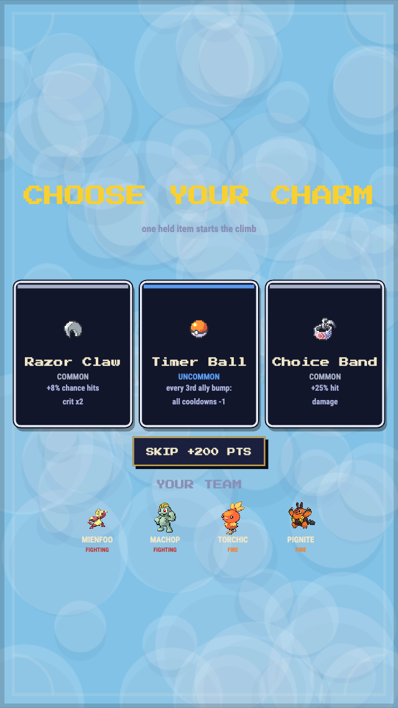
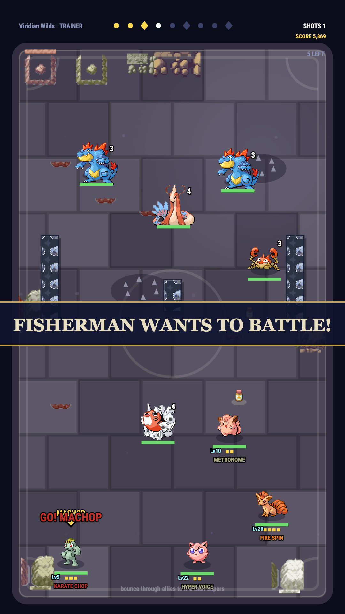
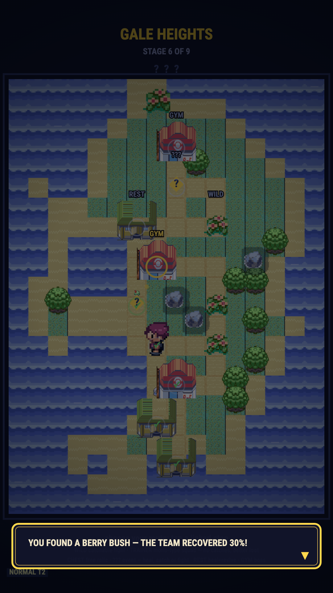
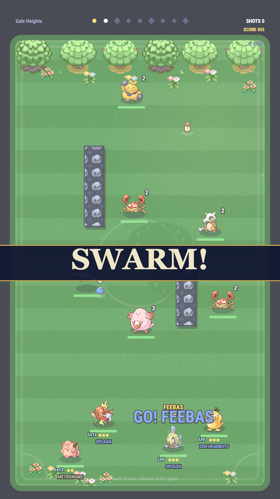
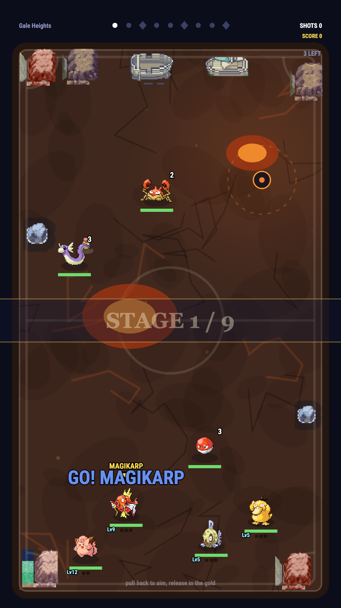
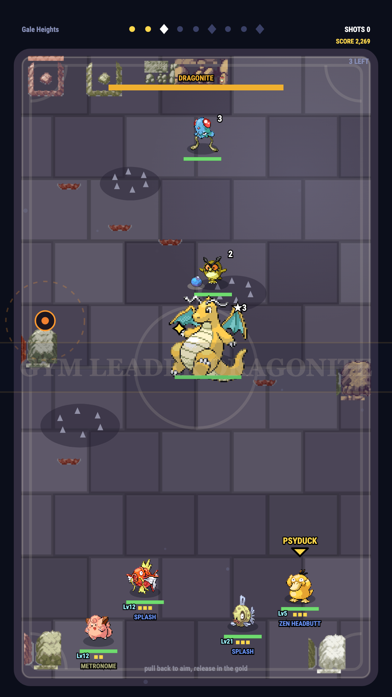
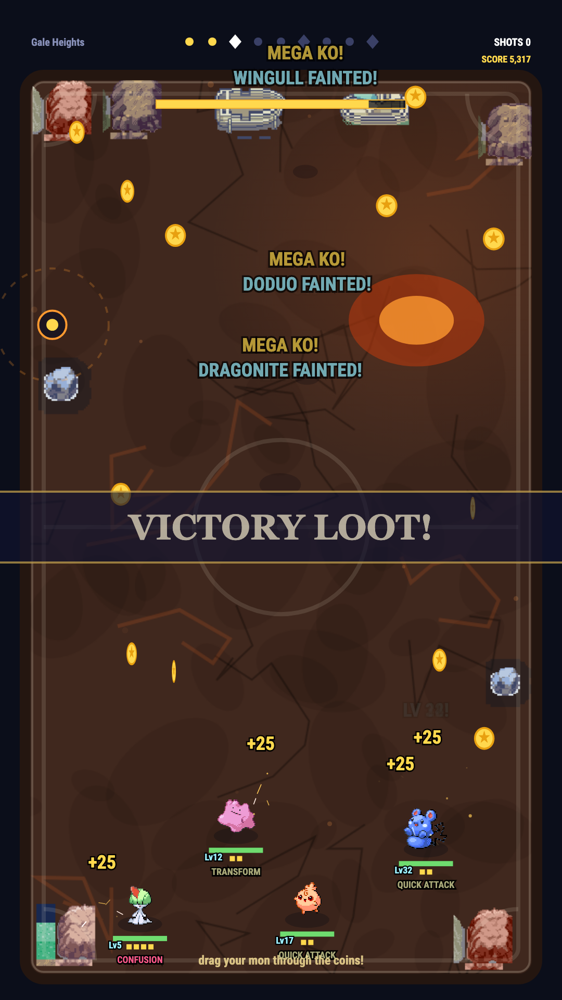
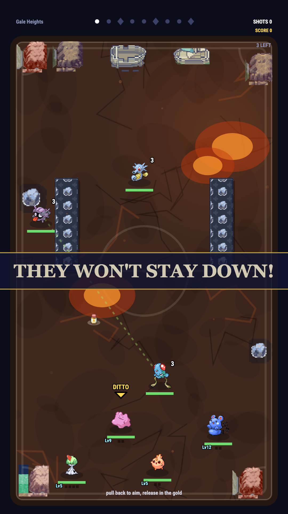
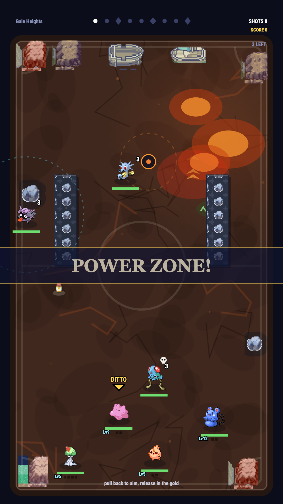

# Pokéstrike

**Monster Strike physics in a Pokémon skin, with a Slay the Spire climb.**
Pull back, launch your Pokémon, and bounce it around the arena smashing wild
mons. Draft a team of 4, climb 9 stages, and take down all three gym
leaders to win the run.

| Title | Draft | Battle |
| --- | --- | --- |
|  |  |  |

| Region map | Aiming | Reward |
| --- | --- | --- |
|  |  |  |

| Charm pick | Trainer battle | ? Event |
| --- | --- | --- |
|  |  |  |

| Wave mutator | Mines | Boss weak point |
| --- | --- | --- |
|  |  |  |

| Victory loot | Soul-linked pair | Power zone + auras |
| --- | --- | --- |
|  |  |  |

## How to play

```bash
npm install
npm run dev    # serves on 0.0.0.0, open the printed Network URL on your phone
```

The game is also deployed to GitHub Pages on every push to `main`
(`.github/workflows/deploy.yml`), so you can play from any device at
`https://<user>.github.io/pokestrike/`.

Open the printed URL. Works on desktop and touch. The `?` button opens a
scrollable in-game manual, and it opens itself on your first visit.

1. Hit **Free Play** for a 9-stage climb (Slay the Spire style): random wild
   stages, a **gym leader** every 3rd stage, bigger and meaner packs as you
   go, and a win only when the third gym falls.
   (`?seed=NNN` on the URL forces any seed, handy for sharing or debugging
   a run.) Enemy typing is hidden (`?`)
   until a mon takes a hit or attacks; you learn the matchup by engaging.
   Gym leaders bring same-type entourages and a **signature attack** (Mewtwo
   hunts you with psychic orbs, Dragonite fires a hyper beam line,
   Gyarados sweeps the court, Charizard scorches a ring), and every gym
   you beat lets you **keep the leader's ace** for your own team.
2. **Draft your team.** Four rounds, one of three Pokémon each round, from a
   29-species pool of unevolved starters. Every round offers **three
   different types** so teams stay varied. The heavy hitters (Gengar,
   Snorlax, Dragonite...) aren't in the draft at all; you catch them mid-run.
   Each card shows the mon's **role** at a glance: **SPEEDSTER** (fast
   shot, combos), **TANK** (huge HP), **SNIPER** (long-range super,
   frail), **BRUISER** (heavy hits), **HEALER** (super heals the team),
   **WILD** (all-rounder), plus its full base-stat block and any trait
   tag: **PIERCE** sails straight through enemies instead of bouncing off
   them, and **COPY** (Ditto) replays the super, stats, typing and
   cooldown, of whichever ally bumps it.
3. **Pull back to aim.** Drag direction sets your launch angle and a dotted
   **guide line** previews the ball's banks off walls and rocks, ending on
   whatever it would hit first. **Power is timing**: a
   meter ping-pongs while you hold, so release inside the gold band for a
   full-power `PERFECT!` shot (shockwave, slow-mo and all). The band's
   spot is the mon's own, set by base Speed: fast mons sit high and tight,
   slow mons get a lower, wider target. Every wall
   **bank** on the way pays +8% contact damage on the hits that follow, the
   Monster Strike trick-shot fantasy, and stone blocks count.
4. Every enemy you bump takes damage with **type effectiveness**. Gold `!`
   numbers are super effective, grey means resisted (or immune).
5. **Bump your own teammates.** Every pass-through is a combo link (rising
   ×N counter, escalating hit-stop and flashes), and each link **powers up
   the launch**: +10% contact damage and a momentum kick per bump, so
   routing through the whole team turns a good shot into a rampage. Each
   ally's
   signature **super** starts uncharged and builds one notch per shot. The
   pip meter under its HP bar fills as it charges, all-gold means ready,
   and its move name appears overhead; that's the one you want to hit
   next. Enemies creep and dart toward your team and attack on a
   **countdown**, so kill them or keep moving. Wild **healers** patch their
   most-wounded ally instead of attacking (kill the cleric first or the
   fight drags), and bosses
   **enrage** under 30% HP, attack timers cycling a third faster. Bosses
   also carry a drifting gold **weak point** on their rim — contact on
   that face pays triple — and **cry for help** at 2/3 and 1/3 HP,
   flooding the court with adds that halve the damage they take until
   you clear them. Every third boss attack is a teleport hop, so no
   pocket stays safe.
6. **Read the field.** Each wave re-themes the court and the wilds match
   the stage's biome: grove draws grass-and-bird packs, cavern
   rock-and-ghost, volcano fire packs, sky flyers and electric, right down
   to ambient embers, petals, and wisps drifting over the floor.
   **Stone clusters** stand mid-court as bounceable cover; bank off them
   like walls for the same per-bounce damage bonus. The court
   fights back too — but only against you (enemies take no environment
   damage): **lava pools** scorch the ball, **tall grass** drags your
   launch to a crawl, **wind bands** push the ball sideways, **spike
   strips** chip it on contact, and **mine pads** detonate when the ball
   touches them — the blast still chips you, but it shoves the pack
   around for free repositioning. Deep waves can roll a **mutator**: SWARM
   floods in extra fodder, HASTY starts timers low, VOLATILE makes KOs
   burst onto neighbors, A BIG ONE supersizes a fodder, a gold glint
   guarantees one shiny in the pack, and a **soul-linked pair** shares a
   green tether — fell one and its partner drags it back at partial HP
   (twice each, then they're done), so drop both in the same shot.
   Rarer affixes: a **skull-marked foe** pays a team heal + score bounty
   on KO, a **gravity aura** carrier slows your ball to a crawl inside
   its bubble, and a **power zone** paints an ATK field — shots landing
   from inside it hit +50% harder. An
   **Air Balloon** item floats over all of it. **Field pickups** spawn
   each wave and the ball collects them by touch: **Oran Berry** heals the
   team, **Protein** boosts contact damage for the rest of the shot,
   **Elixir** knocks a notch off every super's cooldown. Heavy hits scar
   the court, and some spawn pairs sit close enough to squeeze the ball
   between them for multi-hits. **Combo shots**: when the ball touches two
   different things — foe, ally, wall, stone — inside a 0.35s window, the
   second contact flashes `COMBO SHOT!` (banks only count while the ball
   still has speed). Relics are what make them pay: **Binding Band** gives
   +40% contact damage on the hit and **Ether** feeds the launcher a
   super pip.
7. **Catch 'em.** A KO has a chance to send the enemy to your **box**
   (`CAUGHT!` ball wiggle and all); beating a **gym leader** is the only
   guaranteed catch — their ace joins you, and the boss bursts into a
   **coin shower**: a few seconds to drag your mon through the spinning
   PokéCoins before they fade, +25 score each. Swap boxed
   mons onto the team freely between stages. HP follows the mon, so
   benching never heals or revives. A **duplicate** catch doesn't waste a
   slot: it feeds the copy you own, evolving the mon if its line has a
   next stage or becoming **rare candy** (a stat bump, or a team
   heal if it's benched). Evolved **elites** start appearing from stage 2
   and get common deeper in, and any normal wave can be **invaded** by a
   legendary (the birds, the beasts, Mew, Celebi) crashing in as a
   mini-boss worth catching. Bosses can be caught mid-fight too, and a
   Master Ball item never fails. Rare **shiny** wilds (~1 in 48 spawns)
   sparkle gold; KO one and it's a guaranteed catch plus a score bonus.
   Fill 100 dex entries for the **Shiny Charm**, which doubles every shiny
   roll from then on.
8. **Choose a item between stages** (Slay the Spire style): heals, +max HP,
   +damage, faster recharges, launch speed, revive. Builds stack across the
   run, so draft for synergy and item for the holes. Cold board? **Decline**
   the reward for +150 score instead. **Type charms** (Charcoal,
   Mystic Water, Magnet...) give +20% to one type and stack; going mono-type
   is a real build (they only roll for types you actually field). Then pick
   your **route** on the region map: non-gym rows
   offer 1-2 linked stops to tap: safe **wilds** (catchable fights),
   **trainers** (a real NPC class fields a mono-type squad — no catches,
   no shinies, but elite-tier loot), **chests** (a free relic),
   **Poké Center rests** (full heal and fainted mons revived), and **?**
   event stops — a roll from the event pool: a heal, a free catch, a
   rare candy stash, a wonder trade, an egg that hatches a few stops
   later, or an ambush (an alpha guarding treasure, a wild pack) that
   fields a scripted wave. Field two or more mons of one type and its
   **type trait** kicks in (shinies count double, fainted mons don't):
   fire burns brighter, ghosts execute low foes, psychic hits splash —
   tiers show as chips under the map. Waves that outlast 10 shots ramp
   enemy damage, so stalls get punished. Gyms are
   forced singles every third row; the island itself is a seeded
   porygion-style value-noise map. The items you've taken ride the reward
   screen as an icon strip.
9. **It remembers you.** Caught mons join your **dex** and can show up in
   future draft pools; gym wins raise your **rank**, and higher ranks unlock
   gated items in the pool. Your **best score** lives on
   the title screen. Tap the dex count on the title for the **Pokédex**, every
   catchable species lit when owned. Lose a run and that exact team comes
   back as a **RIVAL BATTLE**
   wave in your next one, at the levels it earned, shinies included.
   Beat it to clear the echo. Every clear raises
   your **ascension** (shown on the title): enemies get +15% bulk and +8%
   damage per tier, and pay a +20%/tier score premium.
9b. **Level up mid-run**: every KO feeds the mon that landed it levels.
    Bigger foes teach more, and punching above your weight pays double.
    Stats grow on the real Gen-3 formula (up to Lv 100), so a high-level
    carry is a different monster entirely. Levels survive evolution and
    benching since they follow the mon. Feed your carry, not your bench.
9c. **Signature moves**: drafted and caught mons shout their *own* move
    (Pikachu `THUNDERBOLT`, Gyarados `TWISTER`, Mewtwo `PSYCHO BOOST`),
    and draft cards show the super you'll unlock. Draft cards can roll
    **shiny** (~1 in 50) too; a gold card stays gold for the whole run.
9d. **Before stage 1, choose your charm**: one of three held items to
    start the climb with (shown against your drafted team), after a
    one-per-run draft **reroll** if the board is cold. Or **SKIP** the
    charm entirely for +200 score.
9e. **Perfect streaks and revenge**: back-to-back gold releases stack up
    to +28% shot damage (watch `PERFECT ×n` in the HUD); a fainted
    teammate surges the survivors +8% damage and a sip of HP.
10. **Share your result.** The result screen shows a Wordle-style emoji grid
    (🟩 cleared waves, 🟥 where you fell), your final team as real sprites,
    rarity-colored **run badges** (FLAWLESS, MEGA KO, BOSS THIEF, SHINY
    HUNTER...), an MVP star on your carry, a "N pts short of your best"
    hook, and a `★ NEW RECORD ★` when you top it. **SHARE RESULT**
    posts a trainer-card readout (team names, score, badges, the grid) and
    **REMATCH** drops you straight into a fresh draft.

## Real stats, real roles

Every species carries its canonical base stats (HP / Atk / Def / SpA / SpD /
Spe). The mapping is one rule: **physical attacks roll Attack vs Defense,
special attacks roll Sp.Atk vs Sp.Def.**

| Stat | What it does in Pokéstrike |
| --- | --- |
| HP | Max HP (players `60 + 1.15×`, bosses `5.8×`) |
| Attack | Damage when your launched Pokémon physically hits an enemy |
| Defense | Shrinks physical damage taken: contact hits and enemy zaps |
| Sp. Atk | Damage of the bump combo when an ally is hit mid-shot |
| Sp. Def | Shrinks special damage taken: boss blasts, poison ticks |
| Speed | Launch velocity for your team; approach speed for enemies |

So Pikachu (55 Atk / 90 Spe) is a fast skirmisher, Jigglypuff (115 HP / 20
Spe) is a slow tank, and Geodude's 100 Defense means physical hits bounce off;
hit it with special bump attacks instead. Damage mitigation is
`60 / (60 + def)`, so a defender at 60 takes about half damage.

Supers shout their real move name (`PIKACHU used THUNDER!`), chain lightning
hops enemy to enemy, shockwave rings sweep the field, and everything is
backed by a procedural chiptune soundtrack
(title / battle / victory) plus synthesized WebAudio SFX and haptics. No
audio assets.

## Bump attacks by type

| Type | Ally bump attack |
| --- | --- |
| Fire | Flame Burst: a shockwave ring rolls out from the ally; enemies burn as the front passes over them and get shoved back |
| Electric | Chain lightning: hops between up to 3 enemies, each hit landing a beat apart |
| Grass | Drain field: damages enemies, heals your whole team by a quarter of what it dealt |
| Water | Hydro Pump: three homing orbs corkscrew into the nearest enemies and splash on impact |
| Psychic | Telekinetic shove: damage plus a real knockback impulse that flings enemies off walls and each other |
| Flying | Hurricane: a vortex drags every nearby enemy into a pile on the ally, setting up your next combo |
| Poison | Toxic: an immediate hit plus poison that ticks a cut of max HP after each of your shots; re-toxining stacks it |
| Rock / Fighting | Meteor fist: the nearest enemy eats a one-two; the second hit lands a beat later and scars the court |
| Ghost | Hex: a weak hit on every enemy on the field |
| Normal | Quick Attack: the ally physically dashes to the nearest enemy, slams it, and stays beside it |

## Install it like an app

The game ships a PWA: `manifest.webmanifest`, icons, and a cache-first service
worker (`public/sw.js`) registered only in production builds.

- **iOS**: open the deployed site in Safari → Share → Add to Home Screen
- **Android/desktop**: the install prompt appears in the browser
- **Native wrapper**: `npm run build`, then wrap `dist/` with
  [Capacitor](https://capacitorjs.com) (`npx cap init` → `npx cap add ios`).
  The game is one self-contained static bundle with no backend.

## How it works

- **No engine**: plain TypeScript + Canvas 2D. Physics is custom: slingshot
  launch, wall reflection, circle-vs-circle collisions, friction, knockback.
- **Data-driven**: species + real base stats in `src/game/data.ts`, stat-to-
  mechanic formulas in `src/game/stats.ts`, the type chart in
  `src/game/types.ts`, stages as wave lists with normalized arena coords.
  Adding a Pokémon is a data change, not a code change.
- **Seeded stages**: `makeStage(seed)` builds the opening 3-stage stretch;
  `rollWave` generates deeper stages. A run rolls a fresh seed each time;
  `?seed=NNN` on the URL forces one (draft, stages, rolls all reproduce).
- **Meta persistence**: `src/game/meta.ts` keeps the dex, rank, and the
  rival echo in localStorage between runs.
- **Fixed logical resolution**: 540×960 letterboxed to any window.

```
src/
  core/    vec.ts, loop.ts, assets.ts, rng.ts,  # engine plumbing
           audio.ts                             # chiptune music + synth sfx + haptics
  game/    types.ts, data.ts, stats.ts,         # rules + stat formulas
           perks.ts, bg.ts, meta.ts,            # items, backdrops, persistence
           map.ts, maptiles.ts,                  # seeded region map + atlas tiles
           battle.ts, screens.ts                 # battle scene + title/draft/result
  main.ts                                       # canvas fit + scene state
public/  sprites/ (mons, items, gracidea, cries), manifest.webmanifest, sw.js, icons
```

## Art & credit

All game art is **Pokémon FireRed/LeafGreen (Gen 3 GBA)** era, vendored
from two places:

- Mons: official FRLG battle fronts (64×64, keyed by dex id) from
  [PokeAPI/sprites](https://github.com/PokeAPI/sprites)
  `sprites/pokemon/versions/generation-iii/firered-leafgreen/` →
  `sprites/<id>.png`
- Items: official item icons from the same repo (`sprites/items/`) →
  `sprites/items/<name>.png`
- Scenery: the [Gracidea](https://github.com/lowlighter/gracidea) pack
  (RSE tileset + npcs), vendored into `public/sprites/gracidea/`: court
  edges get real tileset props (trees, boulders, flowers, scorched
  debris)

One era is what keeps the theme cohesive: new art gets vendored or sliced
from these sources, never invented shapes. Hazard zones and court paint
are translucent gameplay markings, not scenery.

Pokémon is © Nintendo / Game Freak / Creatures Inc. This is a fan-made,
non-commercial project, not affiliated with or endorsed by them.

## Roadmap

The climb is the game. Replayability grows in this order, simple first:

- Ascension modifiers: beat the climb, unlock harder runs
- More run variety: species, items, stage gimmicks, invade/ex stages
- Unlockables: dex catches already feed future draft pools; wins could
  unlock new starters and items the same way
